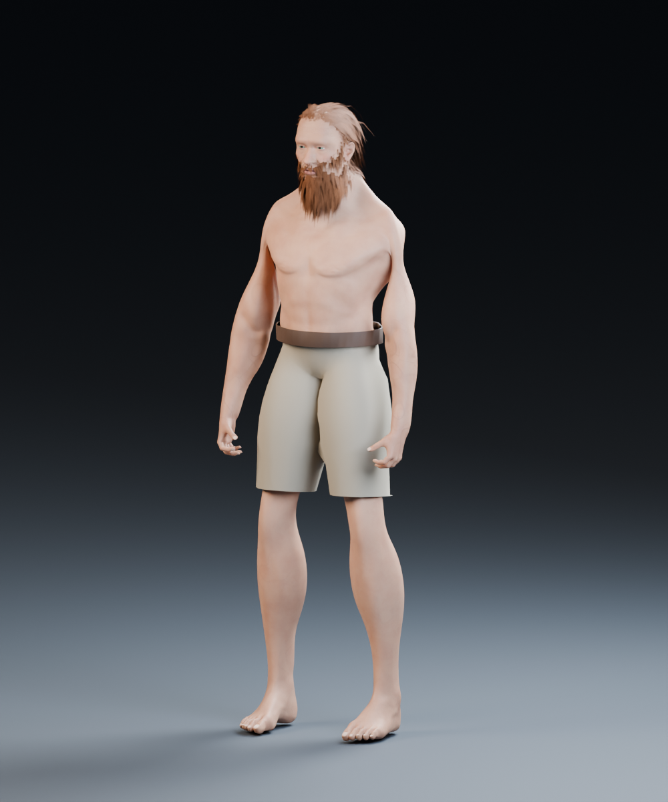

# Character Creations

A reusable character library and a standalone playable testing ground.



## First character: Giantborn's Wanderer

Derived from `darkstalkermap-prog/Giantborne-Age-of-Titans` at commit `bb73c37e635fb70d2d07dc310a3cbd9df37c4add`. The original game repository is unchanged.

- [Character files](characters/giantborn-wanderer/): GLB, FBX, editable Blender scene, textures, original modular assets and build source.
- [Playable testing ground](testing-ground/): walking, running, jumping, orbit camera, animation playback and speed controls, ramps, steps, obstacles and a human-height reference.
- [Download this repository](https://github.com/darkstalkermap-prog/Character-Creations/archive/refs/heads/main.zip). Unzip before opening files.

### Use the character

`characters/giantborn-wanderer/exports/wanderer.glb` is the portable game asset: 71 bones, 28 animation clips, six facial shape controls, embedded PBR textures and a dressed Wanderer appearance. It preserves the source anatomical proportions and height of 3.6576 metres. Skin albedo and normals were newly baked at 2048 x 2048 from the source procedural material, not upscaled from game maps.

`characters/giantborn-wanderer/authoring/wanderer.blend` is the editable Blender 5.3 scene. It includes a unified quad body, non-destructive subdivision (level 1 in the viewport, level 2 in renders), facial controls, skin microdetail, rig, animations, clothing and a lit studio. Hidden original split body meshes remain available. The studio body uses linear skinning because dual-quaternion skinning deformed this imported rig incorrectly during verification.

The game GLB keeps the original split topology. It does not include Blender's higher-resolution subdivision or procedural microdetail. FBX is supplied for other engines; Unreal import and retargeting have not been tested. This is a working first library release, not a claim of final photorealism or medically validated anatomy. Hair uses game-oriented cards; animations are inherited procedural clips, not motion capture. Physics-driven hair/cape motion and Giantborn's custom tattoo and clothing shaders are not reproduced by portable PBR materials.

### Play the testing ground

In the separately supplied Windows portable package, unzip and double-click `Play.cmd`. Its bundled Godot 4.7.2 engine prepares assets and launches the lab; no installation is needed.

From this repository, open `testing-ground/project.godot` in Godot 4.7.2 or newer and press F5. The engine executable is not committed here.

| Control | Action |
| --- | --- |
| WASD / Shift | Move / run |
| Space | Jump |
| Hold right mouse / wheel | Orbit / zoom |
| R or Reset button | Reset position and return to movement |
| Animation dropdown | Individual clip or automatic locomotion |
| Speed slider | Inspect animation at 0.1x to 2x |
| Escape | Release mouse |

Steps are for jumping and collision tests; automatic stair climbing and foot-placement IK are not implemented. Movement uses a capsule collision shape.

### Add characters

1. Create `characters/<character-id>/` with `exports/`, `authoring/`, `textures/`, `previews/`, provenance and a `character.json` manifest.
2. Copy the playable GLB into `testing-ground/models/`.
3. Add `id`, `name`, `model`, `height`, `speed` and `run_speed` to an entry in `testing-ground/characters.json`.
4. For automatic movement, use animation names `idle`, `walk`, `run` and `airborne`. Other clips appear in the dropdown. Export characters standing on Y=0 and facing +Z.

### Use in Giantborn

Preserved `characters/giantborn-wanderer/source/assets/giant/` and `source/data/appearance/` retain the original paths, part IDs, masks, rig and appearance definitions. Use them with Giantborn's existing pipeline. The assembled GLB is a standalone asset, not a drop-in replacement for its modular creator. Integrating new materials or authoring edits requires updating the game's pipeline and checking clothing, first-person splitting and growth deformation there.

### Rebuild and validate

Use Python 3.13 with `bpy==5.3.0`, numpy, scipy and Pillow in an isolated build environment.

```text
python tools/bake_skin.py
python tools/build_wanderer.py
python tools/validate_character.py
godot --headless --path testing-ground --editor --import
godot --headless --path testing-ground -- --qa
```

After rebuilding, copy the exported GLB into `testing-ground/models/wanderer.glb`. `validation.json` records asset checks. The lab's `--qa` checks model loading, movement, jump/landing and clip availability; `--capture` saves a screenshot and exits.

### Provenance and rights

The original body derives from CC0 MakeHuman/MPFB2 data. Retained notices: `source/tools/giant/mpfb2/LICENSE.md`, `SOURCE.md`, and `source/assets/giant/PROVENANCE.md`. The original project describes its generated work as project-owned with the owner choosing the licence; this library does not grant a new blanket third-party licence. Blender and Godot have their own licences. No paid character assets were added.
